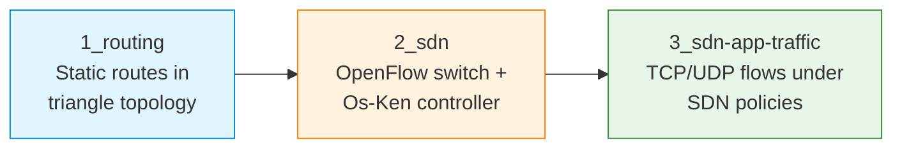

# S06 — SDN, Static Routing and Mininet Topologies

Week 6 introduces software-defined networking and routing within simulated topologies. Students configure static routes in a triangle topology, deploy an OpenFlow-based SDN controller (Os-Ken) and observe how application-level TCP and UDP traffic behaves under different forwarding policies. The seminar bridges the gap between the addressing skills of S05 and the traffic-inspection skills of S07.

## File/Folder Index

| Name | Type | Description |
|---|---|---|
| [`1_routing/`](1_routing/) | Subdir | Triangle topology routing: explanation, Mininet script, tasks (3 files) |
| [`2_sdn/`](2_sdn/) | Subdir | SDN fundamentals: explanation, topology script, Os-Ken controller script, tasks (4 files) |
| [`3_sdn-app-traffic/`](3_sdn-app-traffic/) | Subdir | SDN application traffic: explanation, tasks, TCP and UDP client/server scripts (6 files) |
| [`assets/puml/`](assets/puml/) | Diagrams | 6 PlantUML sources: routing triangle paths, routing triangle topology, SDN app client-server, SDN architecture, OpenFlow topology, SDN traffic policy |
| [`assets/render.sh`](assets/render.sh) | Script | PlantUML batch renderer |

## Visual Overview



## Usage

Run these commands inside the supplied MININET-SDN guest. The classroom deployment script is not needed. Begin with the [VM setup guide](../../01_GUIDE_MININET-SDN/SETUP-GUIDE-COMPNET-EN.md) if this is a new personal-PC installation.

For the triangle routing exercise:

```bash
cd "$HOME/COMPNET-EN/04_SEMINARS/S06/1_routing"
sudo python3 S06_Part01B_Script_Routing_Triangle_Topology.py
```

Exit that topology before starting the SDN exercise. In **SSH Terminal 1**, use the appliance's existing course Python environment and start the Os-Ken controller:

```bash
test -f "$HOME/venvs/compnet/bin/activate" && source "$HOME/venvs/compnet/bin/activate"
cd "$HOME/COMPNET-EN/04_SEMINARS/S06/2_sdn"
command -v osken-manager
osken-manager --ofp-listen-host 127.0.0.1 --ofp-tcp-listen-port 6633 S06_Part02C_Script_SDNOS_Ken_Controller.py
```

In **SSH Terminal 2**:

```bash
cd "$HOME/COMPNET-EN/04_SEMINARS/S06/2_sdn"
sudo python3 S06_Part02B_Script_SDN_Topo_Switch.py
```

The topology connects to `127.0.0.1:6633` using OpenFlow 1.3. Inside its `mininet>` prompt, inspect flows with:

```text
s1 ovs-ofctl -O OpenFlow13 dump-flows s1
```

**Environment compatibility:** the supplied controller imports `os_ken` and subclasses `OSKenApp`. Use `osken-manager` from the working course environment; `ryu-manager` is not an interchangeable launcher for this file. OS-Ken 4.0 removed the `osken` and `osken-manager` CLI tools ([official release notes](https://docs.openstack.org/releasenotes/os-ken/2026.1.html)). If the command is missing, check the existing virtual environment and ask the instructor to restore the course setup instead of installing an unpinned upgrade.

Continue with [Part 2 tasks](2_sdn/S06_Part02D_Tasks_SDN.md) and [Part 3 application traffic](3_sdn-app-traffic/S06_Part03B_Tasks_SDN_App_Traffic.md). Those instructions keep blocking servers and captures separate from the terminal that generates traffic.

## Pedagogical Context

The seminar makes the control plane visible. Traditional routing is experienced first as manual static configuration, then SDN replaces manual routes with programmatic flow rules. By running application traffic (Part 3) under both models, students observe that the forwarding plane is identical from the application's perspective — only the control mechanism differs.

## Cross-References

| Related resource | Path | Relationship |
|---|---|---|
| Lecture C06 — NAT, ARP, DHCP, NDP, ICMP | [`../../03_LECTURES/C06/`](../../03_LECTURES/C06/) | Addressing protocols that operate alongside routing |
| Lecture C07 — Routing protocols | [`../../03_LECTURES/C07/`](../../03_LECTURES/C07/) | Routing theory underpinning Part 1 |
| Quiz Week 06 | [`../../00_APPENDIX/c)studentsQUIZes(multichoice_only)/COMPnet_W06_Questions.md`](../../00_APPENDIX/c%29studentsQUIZes%28multichoice_only%29/COMPnet_W06_Questions.md) | Tests SDN and routing concepts |
| Instructor notes (Romanian) | [`../../00_APPENDIX/d)instructor_NOTES4sem/roCOMPNETclass_S06-instructor-outline-v2.md`](../../00_APPENDIX/d%29instructor_NOTES4sem/roCOMPNETclass_S06-instructor-outline-v2.md) | Romanian delivery guide for S06 |
| HTML support pages | [`../_HTMLsupport/S06/`](../_HTMLsupport/S06/) | 4 browser-viewable HTML renderings |
| Mininet-SDN guide | [`../../01_GUIDE_MININET-SDN/`](../../01_GUIDE_MININET-SDN/) | Environment setup for Mininet and Os-Ken |
| Project A01 — SDN firewall | [`../../02_PROJECTS/02_administration_security/A01_sdn_firewall_filtering_policies_via_openflow_rules.md`](../../02_PROJECTS/02_administration_security/A01_sdn_firewall_filtering_policies_via_openflow_rules.md) | Extends SDN flow rules to filtering policies |
| Project A07 — SDN learning switch | [`../../02_PROJECTS/02_administration_security/A07_sdn_learning_switch_controller_flow_installation_and_ageing.md`](../../02_PROJECTS/02_administration_security/A07_sdn_learning_switch_controller_flow_installation_and_ageing.md) | Builds a learning switch controller |
| Project A09 — SDN IPS | [`../../02_PROJECTS/02_administration_security/A09_sdn_ips_dynamic_blocking_via_openflow_triggered_by_ids_detection.md`](../../02_PROJECTS/02_administration_security/A09_sdn_ips_dynamic_blocking_via_openflow_triggered_by_ids_detection.md) | Combines SDN with intrusion prevention |
| Project S14 — Distance-vector routing | [`../../02_PROJECTS/01_network_applications/S14_didactic_distance_vector_routing_in_mininet_convergence_and_anti_loop.md`](../../02_PROJECTS/01_network_applications/S14_didactic_distance_vector_routing_in_mininet_convergence_and_anti_loop.md) | Implements dynamic routing in Mininet |
| Previous: S05 (subnetting, simulation) | [`../S05/`](../S05/) | Mininet and addressing skills required |
| Next: S07 (sniffing, scanning) | [`../S07/`](../S07/) | Applies packet capture to the topologies studied here |

| Prerequisite | Path | Reason |
|---|---|---|
| Mininet-SDN environment | [`../../01_GUIDE_MININET-SDN/`](../../01_GUIDE_MININET-SDN/) | Required for all three parts |
| Subnetting fundamentals (S05) | [`../S05/`](../S05/) | Address configuration assumed |

**Suggested sequence:** [`../S05/`](../S05/) → this folder → [`../S07/`](../S07/)

## Selective Clone

**Method A — Git sparse-checkout (requires Git 2.25+)**

```bash
git clone --filter=blob:none --sparse https://github.com/antonioclim/COMPNET-EN.git
cd COMPNET-EN
git sparse-checkout set 04_SEMINARS/S06 00_TOOLS
```

To include the Mininet guide:

```bash
git sparse-checkout add 01_GUIDE_MININET-SDN
```

**Method B — Direct download**

```
https://github.com/antonioclim/COMPNET-EN/tree/main/04_SEMINARS/S06
```

---

*Course: COMPNET-EN — ASE Bucharest, CSIE*
